# Catalyst Redesign — Project Documentation

**Course project:** Fundamental UI Redesign  
**Team:** Aayush Keshari, Nipun Chandra, Shivam Kharangate  
**Target UI:** University of Cincinnati Catalyst (student portal)  
**Stack:** SvelteKit + JavaScript (prototype, no backend required)  
**Repo:** https://github.com/nightfury3128/UI-catalyst  
**Figma redesign:** https://www.figma.com/design/QmzVctFez8wJ2DL9re1hA9/Untitled?node-id=0-1  

> **Portfolio note:** Host a personal copy of this write-up on at least one group member’s portfolio page, and keep a fork of the repo under your own GitHub account so the case study stays available after the course ends.

---

## 1. Project overview

UC Catalyst is the university’s central student portal for academics, finances, tasks, and enrollment. Students rely on it for high-stakes, deadline-driven work—especially **finding classes** and **enrolling**—where mistakes are costly and recovery paths are unclear.

We treated this as a **Category A** redesign: the current interface is widely used, but it has significant **usability and design flaws** (learnability, consistency, error recovery, and visual hierarchy), not merely polish issues. The goal was a **fundamental redesign** of how academic tasks connect: one coherent workflow from “what’s due” → “what I’m taking” → “search / cart / enroll” → “am I on track to graduate?”

This repository is a **front-end prototype** that illustrates the redesign. Demo accounts:

| Username | Password | Persona |
| --- | --- | --- |
| `arthur` | `bearcat` | Senior (Jin Sakai) — near graduation |
| `joel` | `bearcat` | Freshman (Joel Miller) — early program |

---

## 2. Critique: what was wrong with Catalyst

### Diagnosis type

**Primarily A — usability / design quality.**  
Students can eventually complete tasks, but the portal makes them spend too much effort figuring out *where to go*, *what just happened*, and *how to recover* when something fails. Secondary **B** angle: the portal prioritizes covering many administrative systems over helping students complete a single high-stakes academic workflow with confidence.

### Focus tasks

1. **Find a class** — open My Academics → Classes and Schedule → Search; set criteria; inspect sections; compare options.
2. **Enroll** — add a section to the enrollment shopping cart; complete registration when eligible; verify the class appears on the schedule.

### Specific problems (from screenshots + class critique)

**Navigation / learnability**

- Related actions use similar labels but different destinations: *Create My Schedule*, *View My Schedule*, *Add/Drop/Edit Classes*, *Enrollment Shopping Cart*.
- Some options open tabs inside the same screen; others launch separate tools—students must **recall** which path works instead of **recognizing** the next step.
- Back controls and return paths were reported as unreliable; filters did not always persist when comparing sections, forcing students to rebuild searches.

**Enrollment status clarity**

- Adding a class to the cart **does not reserve a seat**. The UI must make planning vs. saved selection vs. enrolled unmistakable, and show the next action needed to finish registration.

**Error recovery**

- Messages like “You are not authorized for this page” state failure without a useful next step.
- Class critique reported: Favorites / Recently Visited loops, unclear recovery after unexpected logout, vague prerequisite errors, and a stuck screen after an incorrect Duo code.
- A useful error should name the cause and offer an actionable recovery path (e.g., unmet prerequisite + where to get help).

**Visual hierarchy**

- Campus photography and translucent tiles compete with task labels.
- Most categories get similar emphasis, so urgent work (holds, enrollment window, payment due) does not stand out.
- Reported text overflow / alignment issues on resize.

### Redesign priorities (from critique)

| Priority | Change | Why |
| --- | --- | --- |
| 1 | Connect search → comparison → cart → enrollment in one workflow | Preserve context; clarify status |
| 2 | Prevent avoidable errors; give specific recovery copy | Reduce retries and confusion |
| 3 | Calmer layout with clear urgency hierarchy | Make deadlines and next actions scannable |

**Prototype scope (critique):** academic home, search/results, enrollment feedback — later expanded to progress, finances, and tasks so “what’s next” is visible on Home.

---

## 3. Research, methods, and findings

### Method 1 — Expert heuristic evaluation (Nielsen)

**What we did:** Reviewed Catalyst against heuristics relevant to enrollment (visibility of system status, match between system and real world, user control & freedom, consistency & standards, error prevention, recognition rather than recall, aesthetic and minimalist design, help users recognize/diagnose/recover from errors).

**Findings mapped to redesign:**

| Heuristic | Concrete issue | Design response in prototype |
| --- | --- | --- |
| Visibility of system status | Cart vs enrolled is easy to confuse | Persistent enrollment cart; success/error alerts; enrolled table with status badges |
| User control & freedom | Unreliable return / lost filters | Search + advanced filters stay on the same Classes page; live filter count; Clear filters |
| Consistency & standards | Same “academics” idea split across tools | Single **Classes & schedule** surface with Manage / Create tabs |
| Error prevention | Time conflicts discovered late | Conflict check before cart add and before enroll, with overlapping days/times named |
| Recognition over recall | Related labels, different destinations | Sidebar groups **My Academics** (Classes, Progress); pin favorites |
| Error recovery | Opaque authorization / prereq messages | Actionable flash messages (e.g. conflict with course X on Mon/Wed) |
| Aesthetic & minimalist design | Photo + equal-weight tiles | Flat surfaces, UC red sidebar, urgency on Home “Coming up” |

### Design plan derived from data

1. **Home as command center** — surface holds, tasks, payment, enrollment window, and today’s schedule instead of equal-weight category tiles.
2. **One enrollment workspace** — enrolled list, search, filters, cart, and enroll feedback on `/classes`.
3. **Explicit enrollment states** — cart vs enrolled; confirm before withdraw; conflict blocking with plain-language reasons.
4. **Progress as a second academic pillar** — credits, GPA, remaining requirements, expected graduation, advising contacts on `/progress`.
5. **Navigation that scales** — red sidebar with grouped Academics, pin-to-top, at-a-glance GPA/credits.
6. **Calm visual system** — light/dark theme, strong typography hierarchy, urgency colors reserved for holds/deadlines.

### Sketching and feedback

- **Figma:** frames for Student home, Academic progress, Classes & schedule, Academic services ([link above](https://www.figma.com/design/QmzVctFez8wJ2DL9re1hA9/Untitled?node-id=0-1)).

---

## 4. The redesigned interface

### Information architecture

| Route | Role in redesign |
| --- | --- |
| `/login` | Demo sign-in with clickable demo accounts |
| `/` **Home** | Day-at-a-glance: profile, Coming Up (holds/tasks/pay/enrollment), schedule |
| `/classes` | Manage enrollment + search + cart + enroll (core workflow) |
| `/progress` | Degree progress, timeline, audit, advisors |
| `/finances` | Balance, aid, activity (supports Home urgency) |
| `/tasks` | Service indicators and to-dos |
| `/profile` | Student identity summary |
| `/admissions`, `/scholarships`, `/quick-links`, `/other-tools` | Placeholder pages (scoped out of core redesign) |

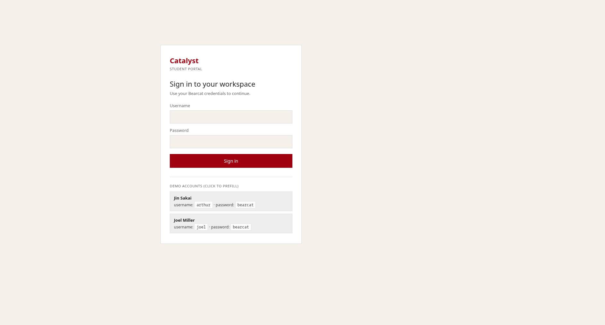

### Home (`/`)

- Greeting + current term chip.
- **Profile card** — identity, program, standing.
- **Coming Up** — prioritized list of holds, tasks, tuition due, enrollment window; links into Tasks / Finances / Classes.
- **Schedule list** — this week’s meetings without leaving Home.

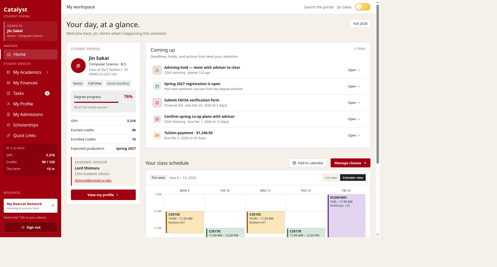

### Classes & schedule (`/classes`) — core redesign surface

- Enrollment window banner when open (assigned time).
- Tabs: **Manage classes** (built) / **Create my schedule** (placeholder).
- Enrolled table: code, schedule, professor, credits, status, Edit / Withdraw (confirm).
- **Enrollment cart** with Remove + Enroll.
- Search by code/title + subject + **More filters** (career, session, campus, days, times, instructor, units, mode, attributes, etc.) with live results and filter count badge.
- Results: seats, fulfills, prerequisites note; **Add to cart** / **Enroll now**.
- Conflict detection blocks cart/enroll with a specific overlap message.
- Success/error alerts that auto-dismiss.

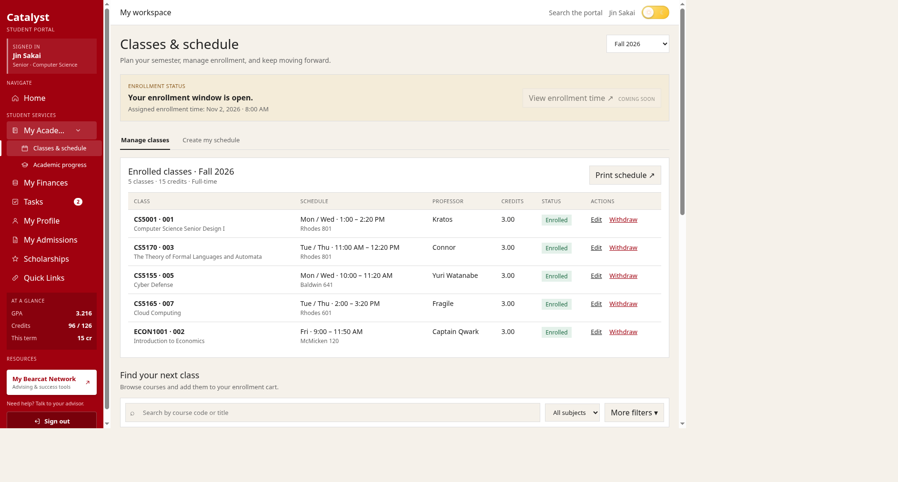

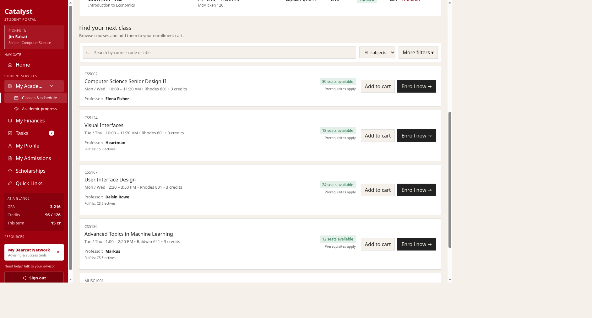

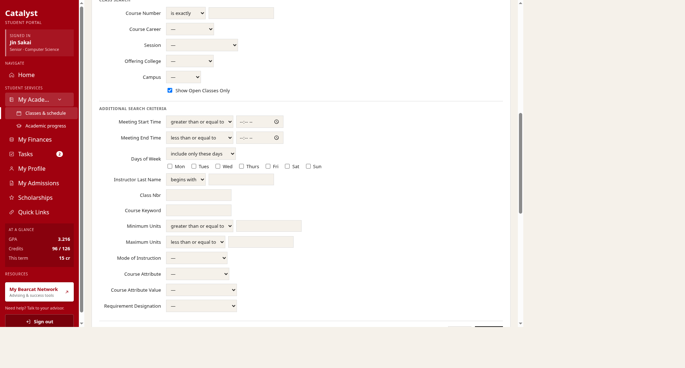

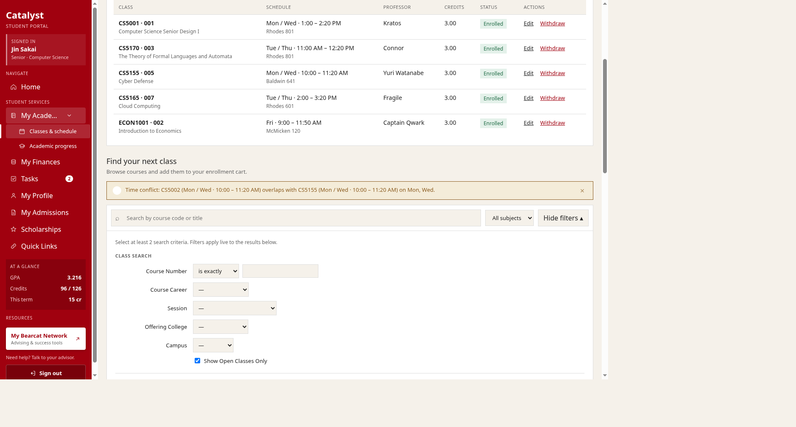

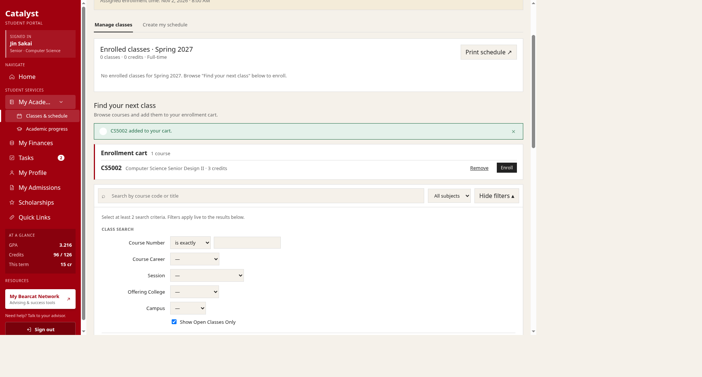

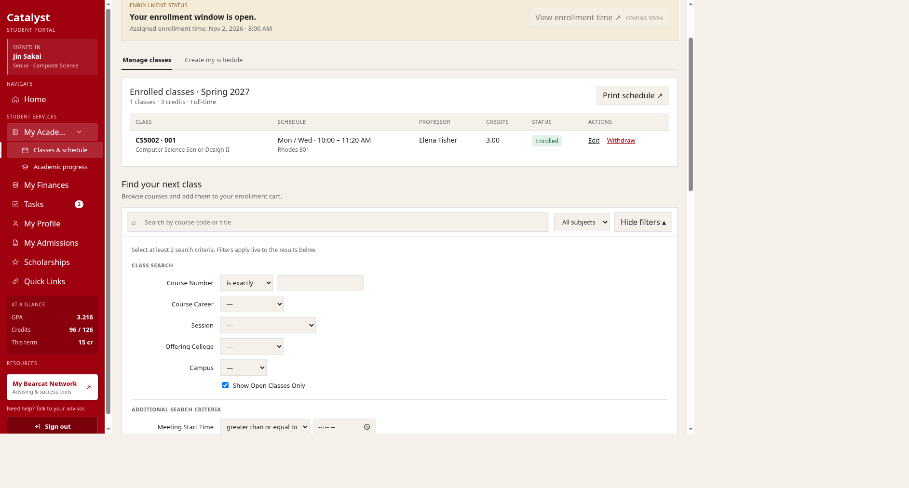

### Academic progress (`/progress`)

- KPI row: earned credits, GPA, remaining credits, expected graduation (updates with current-term enrollment).
- Graduation timeline.
- Degree audit with requirement bars and status badges.
- Advising team + link out to My Bearcat Network.
- Download degree audit (JSON export for the prototype).

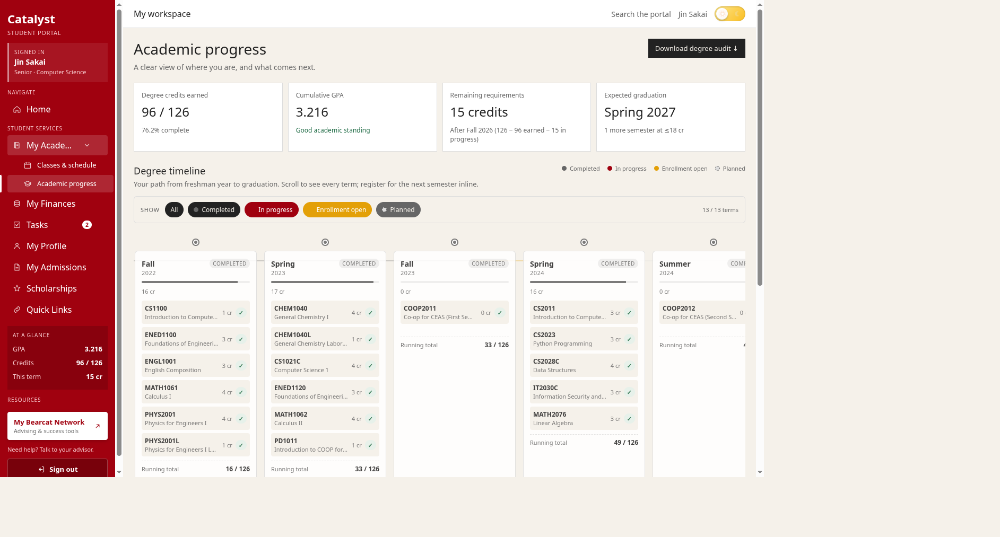

### Shell chrome

- Fixed **UC red sidebar** with brand, pinned nav, My Academics group, services, at-a-glance stats, Bearcat Network, sign out.
- **Top bar** with workspace context and light/dark theme toggle.
- Auth gate: unauthenticated users go to `/login`.

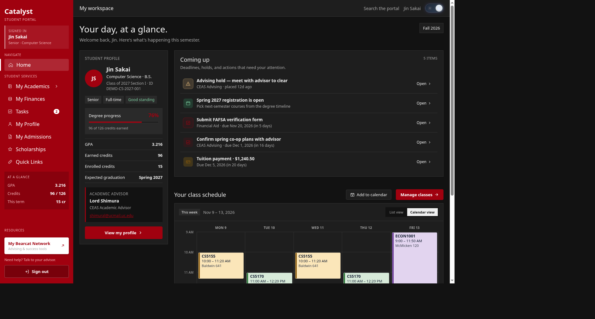

### Finances, tasks, and profile

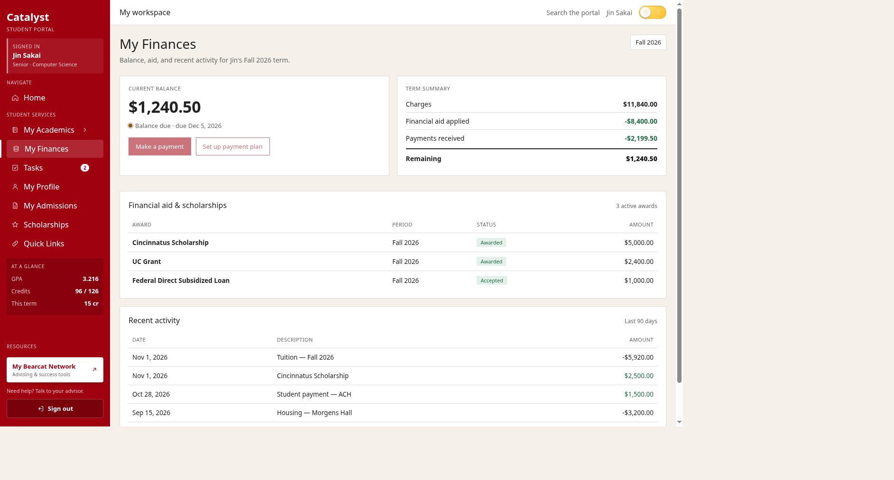

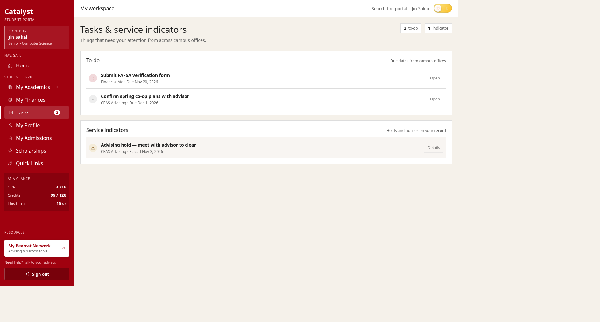

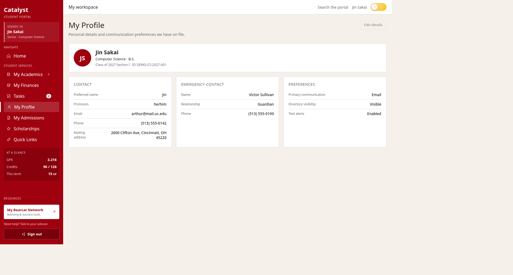

---

## 5. How the critique maps to the build

| Critique finding | Prototype response |
| --- | --- |
| Fragmented class tools | Single `/classes` workflow |
| Lost search context / hard comparison | Filters and results on one page; clear filters |
| Cart ≠ enrolled confusion | Cart panel + enrolled table + explicit alerts |
| Opaque errors | Conflict and enroll messages name courses and times |
| Weak urgency hierarchy | Coming Up prioritizes holds and near deadlines |
| Hard to see “am I on track?” | `/progress` KPIs + audit + expected graduation |
| Navigation memory burden | Grouped Academics + pins + active indicator |

---

## 6. Implementation

### Tech stack

- **SvelteKit 3** + **Svelte 5** (runes: `$state`, `$derived`, `$effect`, `$props`)
- **Vite 8**
- **Vanilla CSS** with design tokens in `src/app.css` / theme store (`src/lib/theme.js`)
- **Client-only mock data** — no required backend or database
- Persistence for demo session: browser storage for auth, enrollment cart/enrolled, and pinned nav

### Code structure

```
src/
  routes/                 # pages (+layout shell, login, home, classes, progress, …)
  lib/
    components/           # Sidebar, TopBar, ProfileCard, ComingUp, ScheduleList, …
    data/                 # student.svelte.js, curriculum, plans, transcripts, users.json
    stores/               # auth, enrollment, pins
    theme.js
```

### Notable front-end behaviors

- Enrollment store drives Home schedule credits, Progress remaining credits, and Classes tables together.
- Two demo personas load different plan/transcript JSON files.
- Print schedule uses `window.print()` with print CSS that hides chrome.
- Responsive breakpoints collapse sidebar and tables for narrower viewports.

### Run locally

```bash
npm install
npm run dev
```

```bash
npm run check
npm run build
```

---

## 7. Use of AI

We used AI assistants to accelerate Figma-to-Svelte scaffolding, CSS layout iteration, and enrollment filter logic and to help with documentation and grading our submission to get an idea how we did 
**Strengths:** faster exploration of layout variants and boilerplate.
**Limitations:** generated code needed manual passes for accessibility (labels, alerts), conflict-detection edge cases, and keeping mock data consistent across Home / Classes / Progress. Design decisions and critique framing remained human-led.

---

Youtube: https://youtu.be/SU5QLjBSpM4